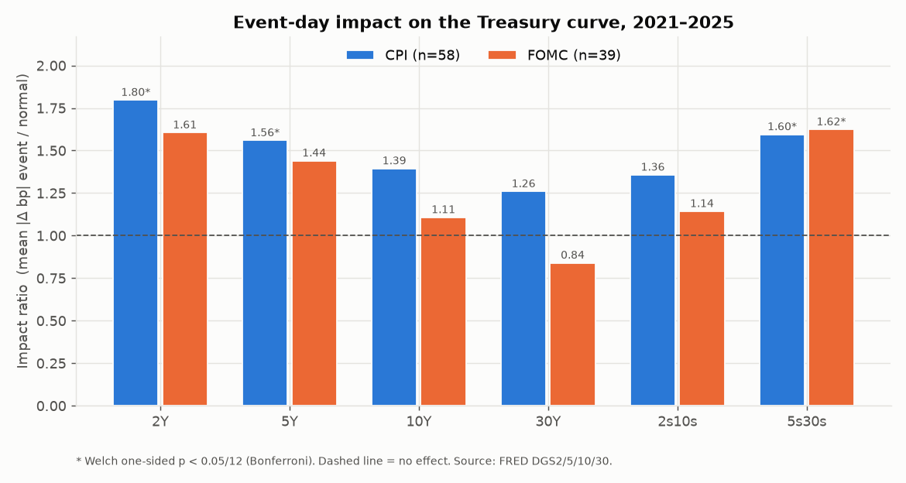
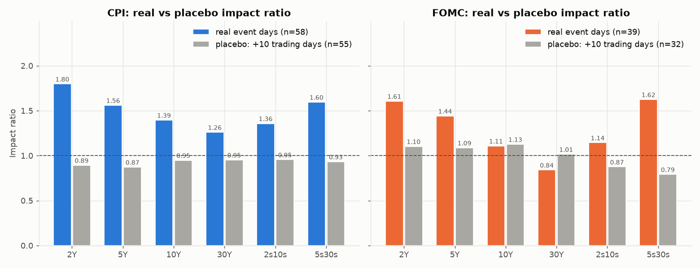
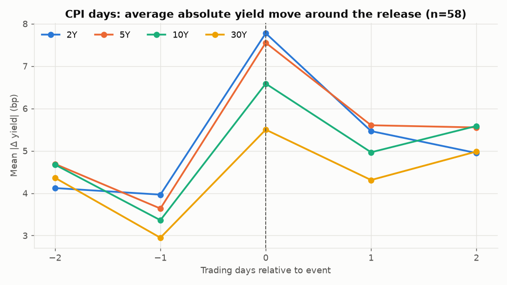
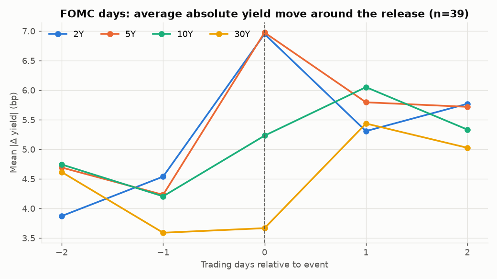
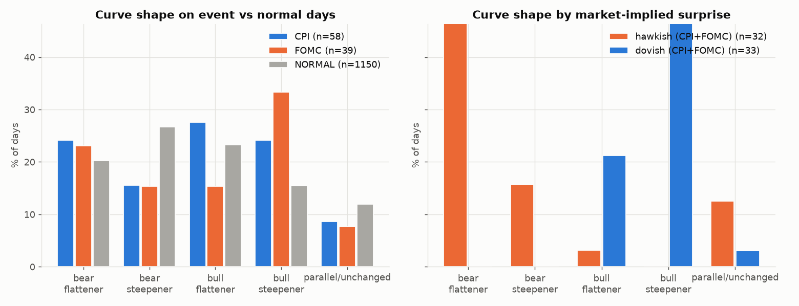
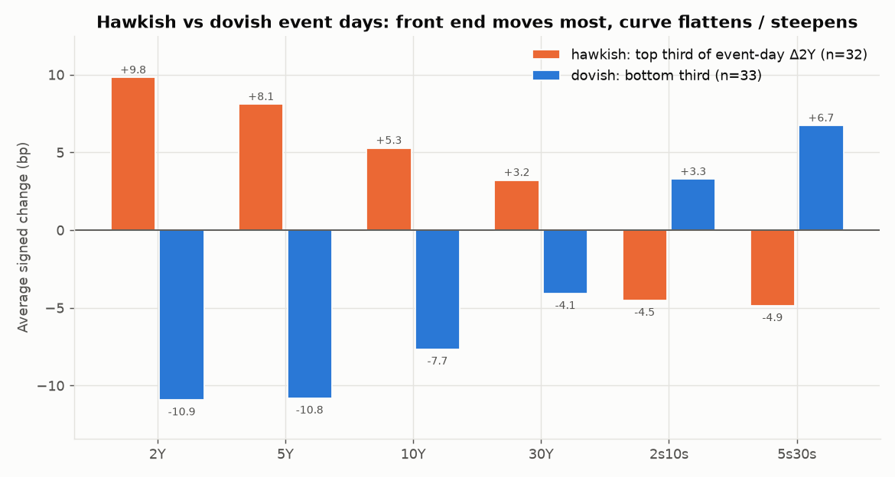
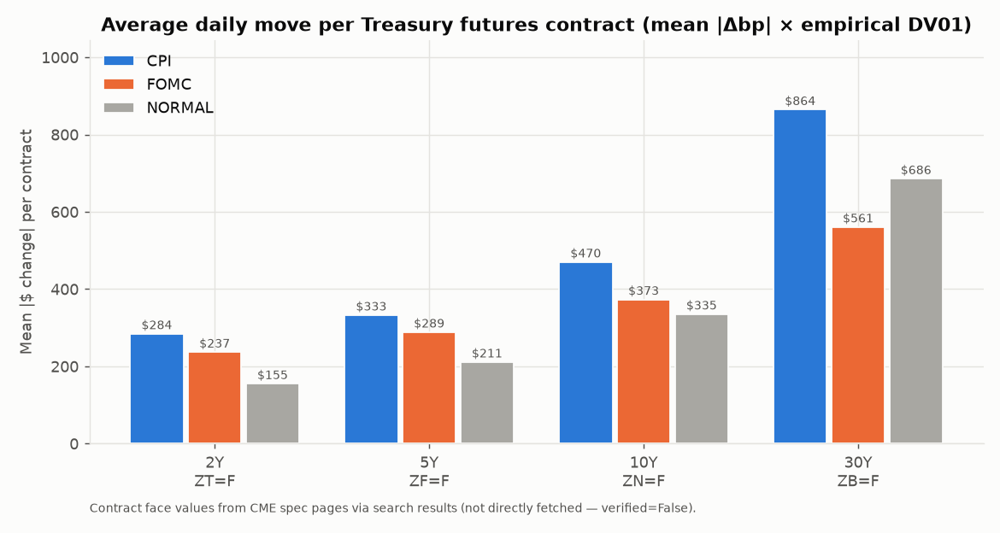

# Macro Event Impact Tracker: US Treasury Curve

> How much, and in which direction, do **US CPI releases** and **FOMC decisions** move the Treasury curve (2Y, 5Y, 10Y, 30Y) and Treasury futures compared with normal days? And does the curve steepen or flatten? An event study on 2021–2025 using only official, sourced data.

**Data:** FRED/ALFRED (St. Louis Fed), BLS, Federal Reserve Board, yfinance · **Period:** 2021-01-01 to 2025-12-31 · **Every input is listed in [`data/SOURCES.md`](data/SOURCES.md)**

---

## Table of Contents
1. [Overview](#1-overview)
2. [Background: The Treasury Curve from Zero](#2-background-the-treasury-curve-from-zero)
3. [Methodology: The Event Study](#3-methodology-the-event-study)
4. [Tech Stack](#4-tech-stack)
5. [Requirements](#5-requirements)
6. [Project Structure](#6-project-structure)
7. [Architecture and Data Flow](#7-architecture-and-data-flow)
8. [How It Is Built (Step by Step)](#8-how-it-is-built-step-by-step)
9. [How to Run](#9-how-to-run)
10. [Design Decisions and Trade-offs](#10-design-decisions-and-trade-offs)
11. [Validation and Sanity Checks](#11-validation-and-sanity-checks)
12. [Results](#12-results)
13. [Limitations](#13-limitations)
14. [Possible Extensions](#14-possible-extensions)
15. [References](#15-references)

---

## 1. Overview

A few scheduled macro announcements cause outsized moves in rates. This project builds a reproducible **event study** of the US Treasury curve:

1. Downloads official daily **constant-maturity Treasury yields** from FRED (`DGS2`, `DGS5`, `DGS10`, `DGS30`) and the **Fed funds target** (`DFEDTARU`). It works in **basis-point changes** and derives the **2s10s** and **5s30s** curve spreads.
2. Builds the **event calendar** from official sources and cross-checks each date against a second source:
   - **CPI release dates:** BLS, checked against ALFRED vintage dates.
   - **FOMC decision days:** federalreserve.gov, checked against the date in each statement link.
3. Tags every trading day **CPI**, **FOMC**, **BOTH** (excluded) or **NORMAL**.
4. Computes the **Impact Ratio** for each tenor and spread, and tests it with Welch and Mann–Whitney, Bonferroni correction and a **placebo** test.
5. Studies **direction**:
   - a market-implied hawkish/dovish surprise from the 2Y yield
   - curve-shape classification (bear/bull × steepener/flattener)
   - signed moves
   - a Δ10Y-on-Δ2Y beta
   - a **2022 hiking-cycle regime split**
6. Translates the moves into **$ per futures contract** (ZT/ZF/ZN/ZB) using empirically estimated DV01s, after detecting and removing **continuous-contract roll artifacts**. An optional **30-Day Fed Funds futures (ZQ)** module shows how the money market re-prices on FOMC days.

**Main outputs:**
- `outputs/impact_table.csv`
- `outputs/curve_shape_table.csv`
- `outputs/signed_moves_table.csv`
- `outputs/dv01_table.csv`
- seven charts
- the findings in §12

---

## 2. Background: The Treasury Curve from Zero

### 2.1 The events
| Event | What it is | Who releases it | Frequency | Release time (ET) |
|---|---|---|---|---|
| **CPI** | Change in the prices consumers pay, i.e. inflation | U.S. Bureau of Labor Statistics | Monthly | 8:30 a.m. |
| **FOMC decision** | Sets the federal funds target range; statement, plus projections at quarterly meetings | Federal Reserve | 8 scheduled meetings a year | 2:00 p.m., press conference 2:30 p.m. |

In our sample the Fed **raised** the target 11 times (2022-03 to 2023-07, including four +75 bp hikes) and **cut** it 6 times (2024-09 to 2025-12), according to FRED `DFEDTARU`.

### 2.2 Yield vs price
A Treasury pays fixed coupons. If market yields rise, an existing bond's price must fall until its yield matches the market. So **yield up means price down**. Treasury futures track bond prices, so they **fall** when yields rise.

### 2.3 Basis points and DV01
- **1 bp = 0.01 percentage point**, so a move from 3.06% to 3.40% is +34 bp.
- **DV01** is the $ change in value for a 1 bp yield move. For one 10Y note future (ZN) we estimate **≈ $71 per bp** (§12.6).

### 2.4 The curve and its shapes
- **2s10s = 10Y − 2Y** and **5s30s = 30Y − 5Y**, both in bp. A negative value means the curve is inverted.
- **Bear** means yields rise and **bull** means yields fall.
- **Steepener** means the spread widens and **flattener** means it narrows.

| Shape | What happens | Typical driver |
|---|---|---|
| Bear flattener | 2Y up more than 10Y | Hawkish surprise: the front end re-prices the Fed |
| Bear steepener | 10Y up more than 2Y | Term premium, supply, growth |
| Bull steepener | 2Y down more than 10Y | Dovish surprise: markets price cuts |
| Bull flattener | 10Y down more than 2Y | Growth scare, flight to duration |

### 2.5 Why the 2Y yield is the policy gauge
A 2Y yield ≈ the average expected policy rate over two years plus a small, slow-moving term premium. A *jump* in the 2Y on a release day is therefore the market revising the expected Fed path. We use it as a real, free, **market-implied surprise** (§3.6).

### 2.6 The transmission chain
```
Hot CPI / hawkish FOMC
  → expected Fed path ↑ → 2Y yield ↑ strongly
      → 10Y/30Y ↑ less (long end also prices slower growth/inflation later)
          → 2s10s narrows = BEAR FLATTENER → ZT/ZF/ZN/ZB futures prices ↓
Cool CPI / dovish FOMC → the mirror image: BULL STEEPENER, futures ↑
```

---

## 3. Methodology: The Event Study

### 3.1 Definitions
```
Yield change (bp)      Δy_t   = (y_t − y_{t−1}) × 100       (t−1 = previous trading day)
Spread change          Δ2s10s = Δ10Y − Δ2Y,  Δ5s30s = Δ30Y − Δ5Y
Mean |move| (event)    m_e    = mean(|Δ|) on event days
Mean |move| (normal)   m_n    = mean(|Δ|) on NORMAL days
Impact Ratio           IR     = m_e / m_n        (IR = 1 → no effect)
```

### 3.2 Why mean |Δ| against mean |Δ|?
Comparing like with like is clean and easy to explain. The std on event and normal days is reported alongside it.

### 3.3 Worked example (real data)
```
CPI days, 2Y: mean |Δ| = 7.78 bp (n=58);  normal days: 4.33 bp (n=1,150)
IR = 7.78 / 4.33 = 1.80
```

### 3.4 Hypothesis tests and multiple testing
- **H₀:** event-day |Δ| comes from the same distribution as normal-day |Δ|.
- **H₁:** event-day |Δ| is larger (one-sided).

| Test | Assumes | Why |
|---|---|---|
| Welch t-test | Approximately normal means; **unequal variances allowed** | Event days are more volatile |
| Mann–Whitney U | Nothing about normality (rank-based) | bp changes are fat-tailed |

There are 6 measures × 2 events = **12 tests**. At α = 5%, the chance of at least one false positive if nothing were real is 1 − 0.95¹² ≈ 46%. **Bonferroni** requires p < 0.05/12 = **0.0042**. Raw and adjusted results are both reported.

### 3.5 Placebo and event window
- **Placebo:** shift every event **+10 trading days** and recompute the IR. Placebo days that land on real events are dropped, and real event days never enter the placebo baseline. If the effect is real, placebo IRs fall to about 1.
- **Event window:** mean |Δ| at offsets −2…+2 **trading days**, by row position.

### 3.6 Direction: surprise, curve shape, beta, regimes
- **Market-implied surprise:** within each event type, rank the event-day Δ2Y. The top third is **hawkish**, the middle third neutral and the bottom third **dovish**.
- **CPI first print:** month-on-month CPI % *as first published*, computed inside the release-day ALFRED vintage of `CPIAUCSL`. We report its correlation with Δ2Y. **This is not a consensus surprise**, only the first-printed value.
- **Curve shape:** level = Δ2Y + Δ10Y gives bear (>0) or bull (<0), and slope = Δ2s10s gives steepener (>0) or flattener (<0). Slope = 0 means parallel, and level = 0 with a slope change means twist.
- **Beta:** OLS Δ10Y = a + β·Δ2Y on CPI, FOMC and normal days, with HC1 robust standard errors. β < 1 means a front-end shock flattens or steepens the curve.
- **Regime split:** 2022 against the other years, each compared with its *own* normal days.

### 3.7 Futures translation
- **Alignment:** futures closes are re-indexed to the FRED trading calendar before differencing.
- **Roll artifacts:** fit Δprice ~ Δyield on all days and take robust z-scores of the residuals. Flag |z| > 4 inside roll windows and exclude those days.
- **Empirical DV01:** the slope of Δprice (points) on Δyield (bp) on non-roll-window days, × $ per point (face/100).
- **$ per contract on event days:** mean |Δbp| × DV01. A direct futures-price cross-check is also in `futures_event_dollars.csv`.

---

## 4. Tech Stack

| Tool | Purpose | Why chosen | Alternatives rejected |
|---|---|---|---|
| Python 3.11 | Language | Standard | — |
| pandas / NumPy | Changes, tagging, group-bys | Date indexing, `searchsorted`, vectorised maths | Plain loops: slow and error-prone |
| **fredapi** | FRED yields, Fed target, ALFRED vintages | Official series with no rolls; ALFRED gives *first-release* data and release dates | Treasury.gov CSVs: same data but no vintages; Bloomberg: paid |
| python-dotenv | `FRED_API_KEY` from `.env` | Keeps keys out of code | Hard-coded keys: unsafe |
| **yfinance** | ZT/ZF/ZN/ZB/ZQ continuous futures | Free, covers the full period | Paid vendors (back-adjusted series): cost; CME DataMine: paid |
| requests | Fed calendar page | Simple GET plus cache | Selenium: overkill |
| SciPy | Welch and Mann–Whitney tests | Standard, documented | — |
| statsmodels | OLS with robust SEs (beta, DV01) | Gives SEs and CIs, and t-tests on β = 1 | `np.polyfit`: no inference |
| matplotlib | Static PNG charts | Works offline and in a README | Plotly: unnecessary interactivity |
| pytest | 20 tests including provenance | Catches silent tagging and maths bugs | — |

**Deliberately not used:** intraday data (not free at usable depth), paid consensus forecasts (replaced by the market-implied surprise), and ML models (the question is descriptive and statistical).

---

## 5. Requirements

### 5.1 Functional requirements
| ID | Requirement |
|---|---|
| FR1 | Load DGS2/5/10/30 and DFEDTARU for a configurable period; drop non-trading days (no forward-fill) |
| FR2 | Build `data/events.csv` (date, event, source_url, verified, note) from BLS and the Federal Reserve |
| FR3 | Map events to the same or next trading day; label CPI / FOMC / BOTH / NORMAL; exclude BOTH |
| FR4 | Impact table per (event, measure): means, std, IR, n, Welch and MW p, Bonferroni flags |
| FR5 | Placebo (+10 trading days), event window (−2…+2), curve shapes, signed moves, beta, regime split |
| FR6 | Futures: coverage, roll-artifact detection, empirical DV01, $ per contract; optional ZQ |
| FR7 | Charts and CSV outputs in `outputs/` |

### 5.2 Non-functional requirements
| ID | Requirement |
|---|---|
| NFR1 | **No invented numbers or dates.** Every input has a row in `data/SOURCES.md`; every event has an official URL |
| NFR2 | All downloads cached in `data/raw/` (git-ignored) |
| NFR3 | `FRED_API_KEY` read from `.env` only (git-ignored) |
| NFR4 | n reported next to every statistic; every finding tied to a table value |
| NFR5 | Provenance enforced by tests (`tests/test_pipeline.py`) |

### 5.3 Environment (`requirements.txt`)
```
pandas>=2.0  numpy>=1.24  fredapi>=0.5.1  python-dotenv>=1.0  yfinance>=0.2.40
requests>=2.31  scipy>=1.10  statsmodels>=0.14  matplotlib>=3.7  pytest>=7.0
```
`.env` must contain `FRED_API_KEY=<your key>` (free from fred.stlouisfed.org).

### 5.4 Event calendar (`data/events.csv`)
```
date,event,source_url,verified,note
2022-06-10,CPI,https://www.bls.gov/news.release/archives/cpi_06102022.htm,True,ref month May 2022
2022-06-15,FOMC,https://www.federalreserve.gov/newsevents/pressreleases/monetary20220615a.htm,True,meeting June 14-15*
```
- **CPI:** 59 releases. Dates are read from the official BLS archive links (`cpi_MMDDYYYY.htm`) and **all 59 match ALFRED** first-release dates.
- **FOMC:** 40 scheduled decisions (the second meeting day). **All 40 match** the date in their statement link.
- **Excluded:** the unscheduled 2025-08-22 notation vote, listed in `data/fomc_unscheduled_excluded.csv`.

---

## 6. Project Structure

```
Macro Event Impact Tracker/
├── README.md
├── requirements.txt         .gitignore (.env, data/raw/)      .env (not committed)
├── config.py                # period, FRED IDs, tickers, contract specs, settings
├── provenance.py            # data/sources.json → data/SOURCES.md
├── data_loader.py           # FRED / ALFRED / yfinance / HTML downloads + cache
├── yields.py                # bp changes, curve spreads, data-quality report
├── build_events.py          # official CPI + FOMC calendar → data/events.csv
├── events.py                # load, map to trading days, tag, placebo shift
├── analysis.py              # impact table, Welch/MW, Bonferroni, placebo comparison
├── window.py                # event window −k..+k
├── curve.py                 # curve shapes, surprise terciles, signed moves, beta, CPI first print, regimes
├── futures.py               # roll artifacts, DV01, $ per contract, ZQ module
├── plots.py                 # all PNG charts
├── main.py                  # runs everything
├── data/
│   ├── events.csv  fomc_unscheduled_excluded.csv  sources.json  SOURCES.md
│   └── raw/                 # cached downloads (git-ignored)
├── outputs/                 # tables (.csv), charts (.png), data_quality.md, roll_report.json
└── tests/test_pipeline.py
```

---

## 7. Architecture and Data Flow

```
 BLS archive ─┐                       FRED DGS2/5/10/30 ─▶ yields.py ─▶ Δbp + Δ2s10s/Δ5s30s
 Fed calendar ┼─▶ build_events.py ─▶ events.csv                │
 ALFRED CPI ──┘   (cross-checks)          │                    │
                                          ▼                    ▼
                                      events.py ──── tags (CPI/FOMC/BOTH/NORMAL)
                                                         │
           ┌──────────────────┬──────────────────────────┼─────────────────────┬────────────────────┐
           ▼                  ▼                          ▼                     ▼                    ▼
   analysis.py          window.py                  curve.py               futures.py  ◀── yfinance ZT/ZF/ZN/ZB/ZQ
 impact + placebo     −2..+2 windows      shapes, surprise, signed,    rolls, DV01, $/contract,
                                           beta, regimes, CPI print     ZQ implied rate
           └──────────────────┴──────────────┬───────────┴─────────────────────┘
                                             ▼
                                   plots.py + outputs/*.csv
```

---

## 8. How It Is Built (Step by Step)

| Step | Module / function | What it does |
|---|---|---|
| 0 | `pip install -r requirements.txt`; create `.env` | Setup |
| 1 | `config.py` | `START, END = "2021-01-01", "2025-12-31"`, `TENORS`, `FUTURES`, `CONTRACT_SPECS`, `WINDOW=2`, `PLACEBO_SHIFT=10`, `REGIME_YEAR=2022` |
| 2 | `yields.load_yield_levels` → `bp_changes` → `data_quality_report` | Download, drop the 55 NaN holiday rows, diff × 100; 1,248 daily changes |
| 3 | `build_events.build` | Parse the Fed calendar (second day; Apr/May "30-1" → May 1) and the BLS archive links; cross-check with ALFRED; write `events.csv` |
| 4 | `events.map_to_trading_day` / `tag_days` | `searchsorted` (first trading day ≥ event date); set membership → labels |
| 5 | `analysis.impact_table`, `events.shift_tags`, `analysis.placebo_comparison` | IR, Welch, MW, Bonferroni; +10-day placebo |
| 6 | `window.event_window`, `curve.*` | Windows, shapes, terciles, signed moves, beta, first-print CPI, regime split |
| 7 | `futures.futures_analysis`, `futures.fed_funds_module` | Roll detection, DV01, $ per contract, ZQ |
| 8 | `plots.make_all` | 7 charts |
| 9 | `tests/test_pipeline.py` | 20 tests |

Core tagging logic (`events.py`):
```python
pos = trading_index.searchsorted(event_dates)   # first trading day >= event date
```
Core curve classifier (`curve.py`):
```python
slope, level = d10 - d2, d2 + d10
return f"{'bear' if level > 0 else 'bull'} {'steepener' if slope > 0 else 'flattener'}"
```

---

## 9. How to Run
```bash
python build_events.py   # optional: rebuild + print calendar counts/anomalies
python main.py           # all tables + charts into outputs/
pytest -q                # 20 tests
```

---

## 10. Design Decisions and Trade-offs

| # | Decision | Chosen | Alternatives | Why |
|---|---|---|---|---|
| D1 | Events | CPI and scheduled FOMC | NFP, GDP, PCE | The two biggest scheduled rate events; NFP is the first extension |
| D2 | **Primary series** | **FRED CMT yields (bp)** | Futures % returns | Official, no rolls, comparable across tenors; futures are driven by these yields and are used only for $ translation |
| D3 | Impact measure | Absolute bp change | Signed only | Size captures surprises in both directions; sign is analysed separately (D5) |
| D4 | Baseline | All NORMAL days | Matched pre-event days | Largest control sample; other news on normal days biases IR **down** (conservative) |
| D5 | **Surprise direction** | **Market-implied: event-day Δ2Y terciles** | Consensus (actual − forecast) | Consensus data isn't free; the 2Y *is* the market's real-time policy read. Cost: endogeneity (§13) |
| D6 | CPI value | First print, same ALFRED vintage | Latest revised CPI | Markets traded the first print; revisions came later |
| D7 | Missing days | Drop NaN rows | Forward-fill | Filling creates fake 0 bp days that shrink the baseline |
| D8 | Overlapping CPI and FOMC | BOTH, excluded (1 day: 2024-06-12) | Count in both | Avoids double attribution |
| D9 | Unscheduled Fed actions | Excluded, listed separately | Include | Endogenous to stress |
| D10 | Tests | Welch + Mann–Whitney, one-sided | Student t; two-sided | Unequal variances, fat tails, directional hypothesis |
| D11 | **Multiple testing** | **Bonferroni (α/12)** | Raw p only; Holm/BH | Simple and conservative; raw p also shown |
| D12 | **Roll artifacts** | Residual (robust z > 4) inside roll windows: the prompt's end-Feb/May/Aug/Nov **and** observed expiry windows | Ignore; drop whole windows; back-adjusted series | The data showed Yahoo switches at **expiry** (ZT/ZF on the first day of Jan/Apr/Jul/Oct, ZN/ZB ~20th–23rd of Mar/Jun/Sep/Dec), so a window-only rule would miss most rolls |
| D13 | DV01 | Empirical regression on non-roll days × $/point | Theoretical CTD duration | Uses only our data and the contract multiplier; R² 0.89–0.95 |
| D14 | **Regime split** | 2022 vs other years, own-regime baselines | Pooled only | The 2022 hiking cycle had wilder normal days too; own baselines isolate the event effect |
| D15 | Calendar source | Code-parsed official pages + second-source cross-check | Hand-typed CSV; paid calendar | Auditable; every row has a URL and verified flag |

---

## 11. Validation and Sanity Checks

1. **Event counts:** 12 CPI a year (11 in 2025 because October 2025 CPI was never published during the funding lapse; September 2025 CPI was delayed to 2025-10-24). 8 FOMC every year.
2. **Two-source verification:** 59/59 CPI dates match ALFRED; 40/40 FOMC dates match their statement links.
3. **Data quality** (`outputs/data_quality.md`): 1,249 trading days, 55 holiday rows dropped, 0 partial-NaN rows. The largest move, 2Y −57 bp on 2023-03-13 (SVB), is a known historical event.
4. **Placebo:** all six CPI IRs fall to 0.87–0.95 and FOMC 2Y falls from 1.61 to 1.10 (§12.2).
5. **Futures alignment:** futures trade on some bond-market holidays, so closes are re-indexed to FRED days before differencing (this fixed spurious residuals on 2023-10-10 and 2023-04-10).
6. **Roll report** (`outputs/roll_report.json`): flagged days per contract, which window caught each, and large residuals *outside* windows (reported, not excluded).
7. **Provenance tests** fail if any event lacks an official URL or any input lacks a SOURCES row.

---

## 12. Results

All numbers come from `outputs/` (period 2021-01-05 to 2025-12-31 for changes; 1,150 normal days).

### 12.1 Impact table (`outputs/impact_table.csv`)
| Event | Measure | n event | n normal | Mean abs event (bp) | Mean abs normal (bp) | IR | Welch p | MW p | Bonferroni sig (α=0.0042) |
|---|---|---|---|---|---|---|---|---|---|
| CPI | 2Y | 58 | 1150 | 7.78 | 4.33 | 1.80 | 0.0003 | 0.0001 | both tests |
| CPI | 5Y | 58 | 1150 | 7.55 | 4.84 | 1.56 | 0.0022 | 0.0051 | Welch only |
| CPI | 10Y | 58 | 1150 | 6.59 | 4.72 | 1.39 | 0.0051 | 0.0015 | MW only |
| CPI | 30Y | 58 | 1150 | 5.50 | 4.37 | 1.26 | 0.0343 | 0.0217 | no (raw only) |
| CPI | 2s10s | 58 | 1150 | 4.29 | 3.16 | 1.36 | 0.0172 | 0.0215 | no (raw only) |
| CPI | 5s30s | 58 | 1150 | 4.81 | 3.02 | 1.60 | 0.0004 | 0.0000 | both tests |
| FOMC | 2Y | 39 | 1150 | 6.95 | 4.33 | 1.61 | 0.0077 | 0.0020 | MW only |
| FOMC | 5Y | 39 | 1150 | 6.97 | 4.84 | 1.44 | 0.0143 | 0.0075 | no (raw only) |
| FOMC | 10Y | 39 | 1150 | 5.23 | 4.72 | 1.11 | 0.2287 | 0.2478 | no |
| FOMC | 30Y | 39 | 1150 | 3.67 | 4.37 | 0.84 | 0.9239 | 0.8758 | no |
| FOMC | 2s10s | 39 | 1150 | 3.62 | 3.16 | 1.14 | 0.1877 | 0.2290 | no |
| FOMC | 5s30s | 39 | 1150 | 4.90 | 3.02 | 1.62 | 0.0032 | 0.0014 | both tests |



### 12.2 Placebo (+10 trading days, `outputs/placebo_table.csv`)
| Measure | CPI real → placebo | FOMC real → placebo |
|---|---|---|
| 2Y | 1.80 → 0.89 | 1.61 → 1.10 |
| 5Y | 1.56 → 0.87 | 1.44 → 1.09 |
| 10Y | 1.39 → 0.95 | 1.11 → 1.13 |
| 30Y | 1.26 → 0.95 | 0.84 → 1.01 |
| 2s10s | 1.36 → 0.95 | 1.14 → 0.87 |
| 5s30s | 1.60 → 0.93 | 1.62 → 0.79 |

Placebo n: CPI 55 and FOMC 32 (placebo days that landed on real events were dropped).



### 12.3 Event window (mean |Δ| bp, `outputs/event_window_table.csv`)
| Offset | CPI 2Y | CPI 10Y | FOMC 2Y | FOMC 10Y | FOMC 30Y |
|---|---|---|---|---|---|
| −2 | 4.12 | 4.67 | 3.87 | 4.74 | 4.62 |
| −1 | 3.97 | 3.36 | 4.54 | 4.21 | 3.59 |
| **0** | **7.78** | **6.59** | **6.95** | 5.23 | 3.67 |
| +1 | 5.47 | 4.97 | 5.31 | **6.05** | **5.44** |
| +2 | 4.95 | 5.59 | 5.77 | 5.33 | 5.03 |

 

### 12.4 Curve shape (% of days, `outputs/curve_shape_table.csv`)
| Shape | CPI (n=58) | FOMC (n=39) | Normal (n=1150) | Hawkish (n=32) | Dovish (n=33) |
|---|---|---|---|---|---|
| Bear flattener | 24.1 | 23.1 | 20.3 | **65.6** | 0.0 |
| Bear steepener | 15.5 | 15.4 | 26.7 | 15.6 | 0.0 |
| Bull flattener | 27.6 | 15.4 | 23.3 | 3.1 | 21.2 |
| Bull steepener | 24.1 | **33.3** | 15.5 | 0.0 | **75.8** |
| Parallel/unchanged | 8.6 | 7.7 | 11.9 | 12.5 | 3.0 |
| Twist | 0.0 | 5.1 | 2.3 | 3.1 | 0.0 |



### 12.5 Signed moves and beta (`outputs/signed_moves_table.csv`, `outputs/beta_10y_on_2y.csv`)
| Group (CPI+FOMC) | n | 2Y | 5Y | 10Y | 30Y | 2s10s | 5s30s |
|---|---|---|---|---|---|---|---|
| Hawkish | 32 | +9.81 | +8.09 | +5.28 | +3.22 | −4.53 | −4.88 |
| Neutral | 32 | −0.09 | −0.38 | −0.81 | −0.38 | −0.72 | 0.00 |
| Dovish | 33 | −10.94 | −10.82 | −7.67 | −4.09 | +3.27 | +6.73 |

| Δ10Y on Δ2Y | n | β | 95% CI | R² |
|---|---|---|---|---|
| CPI days | 58 | 0.67 | [0.53, 0.81] | 0.71 |
| FOMC days | 39 | 0.60 | [0.51, 0.70] | 0.77 |
| Normal days | 1150 | 0.72 | [0.65, 0.79] | 0.58 |

**CPI first print vs Δ2Y** (`outputs/cpi_first_print_vs_2y.csv`, n = 58): Pearson r = 0.29 (p = 0.027) and Spearman ρ = 0.35 (p = 0.007). Example: October 2022 CPI first printed at +0.44% MoM, yet the 2Y fell 27 bp on 2022-11-10, a dovish surprise relative to expectations.



### 12.6 Futures: DV01 and $ per contract (`outputs/dv01_table.csv`, `outputs/futures_event_dollars.csv`)
| Tenor | Contract | n fit | Points per bp | R² | $ per point | DV01 ($/bp) | Roll days excluded |
|---|---|---|---|---|---|---|---|
| 2Y | ZT=F | 746 | −0.0183 | 0.93 | 2,000 | 36.57 | 31 |
| 5Y | ZF=F | 746 | −0.0440 | 0.95 | 1,000 | 44.04 | 18 |
| 10Y | ZN=F | 746 | −0.0714 | 0.92 | 1,000 | 71.37 | 16 |
| 30Y | ZB=F | 746 | −0.1572 | 0.89 | 1,000 | 157.18 | 8 |

| Mean \|$ move\| per contract | CPI | FOMC | Normal |
|---|---|---|---|
| ZT (2Y) | $284 | $237 | $155 |
| ZF (5Y) | $333 | $289 | $211 |
| ZN (10Y) | $470 | $373 | $335 |
| ZB (30Y) | $864 | $561 | $686 |

> **Caveat:** contract face values ($200k ZT; $100k ZF/ZN/ZB) come from CME contract-spec pages as shown in search results. cmegroup.com blocked direct fetching, so they are marked `verified=False` in SOURCES.md. Confirm them on cmegroup.com before quoting the $ figures.



**ZQ money-markets module** (`outputs/zq_summary.json`):
- **Scale of the moves:** the implied rate (100 − price) moved a mean 0.63 bp on FOMC days (n = 36, after excluding 3 contract-switch days), against 0.17 bp on normal days (IR 3.6).
- **Largest move:** −4.25 bp on 2024-09-18, the 50 bp cut.
- **Relationship with the 2Y:** the correlation with Δ2Y on FOMC days is −0.28.

### 12.7 Regime split: 2022 vs other years (`outputs/regime_table.csv`)
| Event | Measure | IR 2022 (n) | IR other years (n) | MW p (event \|Δ\| 2022 vs other) |
|---|---|---|---|---|
| CPI | 2Y | 2.44 (12) | 1.56 (46) | 0.005 |
| CPI | 2s10s | 2.35 (12) | 1.06 (46) | 0.006 |
| CPI | 10Y | 1.31 (12) | 1.42 (46) | 0.391 |
| FOMC | 2Y | 1.74 (8) | 1.55 (31) | 0.134 |
| FOMC | 2s10s | 1.73 (8) | 0.97 (31) | 0.006 |

### 12.8 Findings
1. **CPI is the bigger event, and it hits the front end hardest.** CPI days move the 2Y **1.80×** a normal day (7.78 vs 4.33 bp, n = 58, Welch p = 0.0003, significant after Bonferroni). The effect fades along the curve: 5Y 1.56, 10Y 1.39, 30Y 1.26.
2. **FOMC days move the front end but not the long bond on the day.** The 2Y IR is 1.61 (MW p = 0.002, Bonferroni-significant), while the 30Y IR is **0.84**. The long-end reaction arrives a day later: FOMC 30Y mean |Δ| is 3.67 bp on day 0 and 5.44 bp on day +1.
3. **The effect is tied to the release date.** Shifting events by +10 trading days collapses every CPI IR to 0.87–0.95 and FOMC 2Y to 1.10.
4. **Direction:** hawkish event days are **bear flatteners 66% of the time** (2Y +9.81, 10Y +5.28, 2s10s −4.53 bp). Dovish days are **bull steepeners 76% of the time** (2Y −10.94, 10Y −7.67, 2s10s +3.27 bp).
5. **The 10Y moves only 0.60–0.67 bp per 1 bp of 2Y on event days** (FOMC β = 0.60, CPI β = 0.67, both CIs below 1). Policy shocks therefore mostly move the curve's *slope*, through the front end.
6. **Curve spreads react too:** 5s30s IR = 1.60 (CPI) and 1.62 (FOMC), both significant under Bonferroni on both tests.
7. **The 2022 hiking cycle doubled the CPI effect on the curve.** CPI 2Y IR was 2.44 in 2022 against 1.56 otherwise, and CPI 2s10s IR was 2.35 against 1.06 (MW p = 0.005 and 0.006).
8. **In trading terms:** a CPI day moved one ZN contract by about **$470** on average, against $335 on a normal day (DV01 $71.37/bp). One ZT moved $284 against $155.

---

## 13. Limitations

1. **Daily data mixes the event with everything else that day.** Close-to-close changes include other news; intraday data would isolate the 8:30 a.m. and 2:00 p.m. reactions. FOMC press conferences run until about 3:30 p.m. ET, around the FRED closing snapshot, so part of the reaction spills into day +1 (§12.3).
2. **The market-implied surprise is endogenous.** Hawkish and dovish are defined *from* the 2Y move, so the 2Y signed results are mechanical and any same-day news is labelled a surprise. The informative part is how *other* tenors respond given the 2Y.
3. **First-print CPI is not a consensus surprise.** Without free consensus forecasts we can't measure actual − expected; the weak r = 0.29 shows why.
4. **Continuous futures caveats.** Yahoo `=F` series are unadjusted front-month splices. Roll detection is residual-based, and 9 or fewer large residuals per contract *outside* the windows are reported but not removed. Futures close times differ slightly from the FRED snapshot.
5. **Contract face values are not directly verified** (CME blocks automated access); see §12.6.
6. **Small samples:** 58 CPI and 39 FOMC days, and only 12 and 8 in 2022. Bonferroni with 12 tests is conservative, so some real but modest effects (e.g. CPI 30Y, p = 0.034) are reported as not significant after correction.
7. **Regime dependence:** 2021–2025 contains an unusual inflation shock and the fastest hiking cycle in decades.

---

## 14. Possible Extensions

- Add **NFP** and **PCE** releases; add ECB meetings with Bund futures.
- **Consensus surprises** (e.g. from a data vendor) to replace the market-implied proxy.
- **Intraday** futures data around 8:30 a.m. and 2:00 p.m. to remove same-day noise.
- **Bootstrap CIs** for the impact ratios; Holm or Benjamini–Hochberg instead of Bonferroni.
- **SOFR futures (SR3)** for the full expected policy path, beyond the ZQ front month.
- **FOMC statement tone** scored with an NLP model (e.g. *Trillion Dollar Words*) and related to 2s10s.
- **Curve trades:** P&L of a DV01-neutral 2s10s flattener entered on hawkish CPI days.

---

## 15. References

- U.S. Bureau of Labor Statistics: CPI news-release archive, https://www.bls.gov/bls/news-release/cpi.htm
- Federal Reserve: FOMC meeting calendars, https://www.federalreserve.gov/monetarypolicy/fomccalendars.htm
- FRED / ALFRED, Federal Reserve Bank of St. Louis: DGS2, DGS5, DGS10, DGS30, DFEDTARU, CPIAUCSL vintages
- CME Group: Treasury futures and 30-Day Fed Funds futures contract specifications (cmegroup.com)
- MacKinlay, A. C. (1997). "Event Studies in Economics and Finance." *Journal of Economic Literature* 35(1)
- Shah, Paturi & Chava (2023). "Trillion Dollar Words." ACL 2023 (NLP extension)
- SciPy (`ttest_ind`, `mannwhitneyu`) and statsmodels (`OLS`, HC1) documentation
